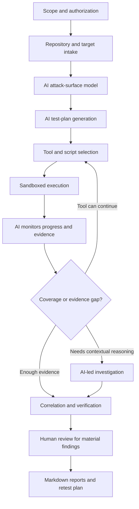

# AI White-box Pentest Orchestrator — Requirements Draft

> สถานะ: Draft v0.1  
> เป้าหมาย: ระบบ AI สำหรับควบคุมและดำเนินการทดสอบความปลอดภัยเว็บที่ได้รับอนุญาต โดยใช้ tools/scripts ก่อน วิเคราะห์ผลแบบต่อเนื่อง และทำ AI-led investigation เมื่อเครื่องมือสำเร็จรูปครอบคลุมไม่ถึง

## 1. Product vision

ระบบต้องทำหน้าที่เป็น **AI Pentest Orchestrator** ไม่ใช่เพียงหน้ารวมผล scanner โดย AI ต้อง:

1. อ่าน scope, source code, configuration และข้อมูล test environment
2. สร้าง attack surface และ test plan ตามบริบทของระบบ
3. เลือก tool หรือ script ที่เหมาะกับแต่ละ test case
4. ตั้งค่าและเรียกใช้ tool ภายในขอบเขตที่ได้รับอนุญาต
5. เฝ้าดู progress, error, coverage และผลลัพธ์ระหว่างการทำงาน
6. ปรับแผน เลือกเครื่องมือใหม่ หรือหยุดงานที่ไม่ให้ข้อมูลเพิ่ม
7. ตรวจสอบและเชื่อมโยงผลจากหลายเครื่องมือกับ source code
8. ทำ AI-led investigation สำหรับช่องโหว่ที่ scanner ตรวจได้ไม่ดี
9. แยกผลที่สงสัยออกจากช่องโหว่ที่ยืนยันแล้ว
10. สร้างเอกสาร Markdown พร้อมหลักฐานและแนวทางแก้ไข

## 2. Initial product scope

### 2.1 In scope for MVP

- White-box assessment ของ web application และ API
- Source code, dependency, secret และ configuration scanning
- Passive และ controlled active testing บน test environment
- Authentication, session และ role-based testing
- OWASP Top 10:2025 mapping
- OWASP WSTG test-case mapping
- REST, OpenAPI และ GraphQL discovery
- Container และ Infrastructure-as-Code checks ที่อยู่ใน repository
- Markdown report และ machine-readable JSON artifacts

### 2.2 Deferred scope

- Production testing แบบ autonomous
- Active Directory และ internal network pentest
- Mobile binary analysis
- Cloud account exploitation
- Social engineering
- Denial-of-service testing
- Persistence, destructive actions หรือการแก้ข้อมูลจริง

## 3. User inputs

ก่อนเริ่ม assessment ระบบต้องรับข้อมูลต่อไปนี้:

- Repository path, Git URL หรือ ZIP
- Commit hash หรือ source version
- Test environment base URL
- Allowed hosts, ports, paths และ HTTP methods
- Explicitly excluded paths และ assets
- Test window และ rate limit
- Test accounts แยกตาม role/tenant
- OpenAPI, GraphQL schema, Postman collection หรือ HAR ถ้ามี
- Framework, language และ deployment information ถ้าทราบ
- Data-handling rules เช่น secret redaction และ retention period
- ระดับ active testing ที่อนุญาต

ระบบต้องไม่เริ่ม active testing จนกว่าจะมี scope ที่ตรวจสอบได้ และ target ต้องตรงกับ allowlist

## 4. Assessment modes

| Mode | การทำงาน | ค่าเริ่มต้น |
|---|---|---:|
| Source only | ตรวจ source, dependencies, secrets และ config | เปิด |
| Passive runtime | Crawl/proxy และวิเคราะห์ traffic โดยไม่เปลี่ยน request เชิงโจมตี | เปิด |
| Active safe | ส่ง payload ที่ไม่แก้ไขหรือลบข้อมูล | ต้องอนุมัติ |
| Active state-changing | ทดสอบ flow ที่สร้างหรือแก้ test data | ต้องอนุมัติราย test plan |
| Destructive/availability | DoS, deletion, persistence หรือ irreversible action | ปิดใน MVP |

## 5. Orchestration workflow



### 5.1 AI responsibilities from the first stage

AI ต้องไม่รอจน scanner ทำงานเสร็จทั้งหมด แต่ต้องทำงานต่อเนื่องดังนี้:

- เลือกเครื่องมือตาม stack และ attack surface
- ลด rules ที่ไม่เกี่ยวข้องเพื่อลดเวลาและ false positives
- สังเกตว่า crawler ครอบคลุม route จาก source code หรือไม่
- ตรวจ error, timeout, authentication loss และ rate-limit response
- หยุดหรือปรับ tool เมื่อผลซ้ำหรือไม่มีข้อมูลใหม่
- สร้าง test case เพิ่มจาก code path ที่ tools ไม่พบ
- เชื่อม finding ที่อาจเป็นสาเหตุเดียวกัน
- เลือก validation step ที่มีผลกระทบน้อยที่สุดก่อน

## 6. Tool registry requirements

เครื่องมือทุกตัวต้องถูกลงทะเบียนเป็น plugin ด้วย metadata ขั้นต่ำ:

```yaml
id: tool-or-script-id
version: pinned-version
categories: [access-control, injection]
capabilities: [discover, detect, validate]
mode: passive | active-safe | active-state-changing
required_inputs: [target, credentials]
supported_technologies: [http, nodejs]
timeout_seconds: 600
max_requests: 1000
network_policy: target-allowlist-only
output_adapter: sarif | json | xml | custom
requires_approval: true
```

ข้อกำหนด:

- `TOOL-001` ระบบต้อง pin เวอร์ชันของ tools และ rules/templates
- `TOOL-002` ทุก tool ต้องทำงานใน isolated worker/container
- `TOOL-003` ทุก tool ต้องมี timeout, request budget และ stop capability
- `TOOL-004` network egress ต้องไปได้เฉพาะ target allowlist และบริการ callback ที่อนุญาต
- `TOOL-005` output ต้องถูกแปลงเป็น finding schema กลาง
- `TOOL-006` ต้องเก็บ command/config hash, tool version, start/end time และ exit status
- `TOOL-007` AI ต้องอธิบายเหตุผลที่เลือก tool และ test case โดยไม่เปิดเผย secret
- `TOOL-008` tool failure ต้องไม่ถูกตีความว่า target ปลอดภัย

## 7. Recommended tool groups

รายการนี้เป็น candidate registry ไม่จำเป็นต้องเปิดใช้ทั้งหมดใน MVP

| งาน | Primary candidates | หน้าที่ |
|---|---|---|
| HTTP probing | httpx, custom probe | ตรวจ live target, technology และ HTTP metadata |
| Crawling | Katana, ZAP Spider/Ajax Spider | ค้นหา route, form, JavaScript และ runtime surface |
| Content discovery | ffuf, feroxbuster | ค้นหา path/file ที่ไม่ถูก link |
| DAST | OWASP ZAP | Passive scan, authenticated crawl, active scan และ API scan |
| Template detection | Nuclei | ตรวจ known exposure, misconfiguration และ known patterns |
| SAST | Semgrep, framework-specific rules | ตรวจ source patterns และ data-flow candidates |
| Dependency/SCA | OSV-Scanner, Trivy | ตรวจ known vulnerable packages/images |
| Secrets | Gitleaks หรือ Trivy secret scanner | ตรวจ credential, token และ private key |
| IaC/container config | Trivy misconfiguration | Dockerfile, Kubernetes, Terraform และ cloud templates |
| TLS | testssl.sh หรือ SSLyze | TLS versions, cipher และ certificate configuration |
| SQL injection validation | sqlmap แบบ targeted | ยืนยันเฉพาะ parameter ที่มี evidence และได้รับอนุมัติ |
| XSS validation | Dalfox หรือ custom browser validation | ตรวจ reflected/stored/DOM execution context |
| Out-of-band callbacks | Interactsh-compatible service ที่ควบคุมได้ | ช่วยยืนยัน blind SSRF/XXE/command execution |
| API schema testing | ZAP API scan, Schemathesis | ตรวจ API จาก OpenAPI/GraphQL contract |
| Authorization | Custom role-differential scripts | เปรียบเทียบ object/action ระหว่าง user, role และ tenant |
| Business logic | AI-generated state-machine tests | ตรวจ workflow, invariant, abuse case และ race candidate |

## 8. Coverage by OWASP Top 10:2025

| Category | Tool/script-first stage | AI verification / investigation |
|---|---|---|
| A01 Broken Access Control | Route inventory, authenticated crawl, role-differential scripts, ZAP access-control support | สร้าง role/action/object matrix, trace middleware-to-query, ตรวจ tenant filter และ workflow bypass |
| A02 Security Misconfiguration | ZAP passive scan, Nuclei, TLS scanner, Trivy config | ตรวจ config override, environment differences และ exploitability ใน deployment จริง |
| A03 Software Supply Chain Failures | OSV-Scanner, Trivy, SBOM/lockfile parser | ตรวจ reachability, package usage, build scripts, provenance และ exposure ของ vulnerable component |
| A04 Cryptographic Failures | TLS scanner, secret scanner, Semgrep crypto rules | ตรวจ key lifecycle, nonce/IV usage, sensitive-data flow และ business impact |
| A05 Injection | ZAP active scan, Semgrep, targeted sqlmap, XSS validator, custom sink probes | trace input-to-sink, ตรวจ sanitization ตาม context และออกแบบ minimal validation request |
| A06 Insecure Design | Architecture parser, threat-model templates | AI-led abuse-case analysis, trust boundaries, missing controls และ security invariants |
| A07 Authentication Failures | ZAP authentication/session support, JWT/session scripts, rate-limit checks | วิเคราะห์ login/reset/MFA flow, account linking และ alternate-channel bypass |
| A08 Software or Data Integrity Failures | Dependency/config scanners, signature and CI config checks | ตรวจ trust path, unsafe deserialization, update mechanism และ untrusted pipeline input |
| A09 Security Logging and Alerting Failures | Log/config rules, test-event scripts | ตรวจว่าเหตุการณ์สำคัญถูกบันทึก เชื่อม correlation ID และไม่รั่วข้อมูลลับ |
| A10 Mishandling of Exceptional Conditions | Fuzzing/error probes, schema/property tests, ZAP | วิเคราะห์ fail-open, partial transaction, resource cleanup และ state inconsistency |

## 9. Additional coverage outside OWASP Top 10

ระบบต้องมี scan domains เพิ่มเติม เพราะ OWASP Top 10 เป็น awareness baseline ไม่ใช่รายการทดสอบทั้งหมด:

- API-specific authorization, mass assignment, inventory และ resource consumption
- Session management และ CSRF
- CORS, CSP และ browser security controls
- File upload และ content-type handling
- WebSocket และ asynchronous endpoints
- GraphQL introspection, authorization และ query constraints
- OAuth/OIDC flow และ redirect handling
- Multi-tenant isolation
- Business-logic abuse และ workflow bypass
- Race conditions และ duplicate transaction
- Privacy/PII exposure
- Dependency, container, IaC และ CI/CD configuration
- Logging, monitoring และ exception handling
- Cache poisoning/caching of sensitive content
- Host/header trust และ reverse-proxy boundary
- SSRF and outbound network policy

## 10. AI-led investigation requirements

AI สามารถเริ่ม investigation เองเมื่อเกิดเงื่อนไขใดเงื่อนไขหนึ่ง:

- Scanner ให้ผลขัดแย้งกัน
- Finding severity สูงแต่ confidence ต่ำ
- Source code แสดง reachable sink แต่ runtime tool ไม่ยืนยัน
- Endpoint จาก source ไม่ปรากฏใน crawl coverage
- พบ authorization หรือ business rule ที่ไม่มี tool รองรับ
- พบหลาย findings ที่อาจเชื่อมเป็น attack chain
- Tool จบด้วย error, authentication loss หรือ incomplete coverage

ข้อกำหนด:

- `AI-001` AI ต้องสร้าง hypothesis ก่อนลงมือทดสอบ
- `AI-002` hypothesis ต้องระบุ evidence ที่มีและ evidence ที่ยังขาด
- `AI-003` AI ต้องเลือก action ที่กระทบน้อยที่สุดเพื่อเติม evidence
- `AI-004` AI สามารถสร้าง script ชั่วคราวได้เฉพาะใน sandbox
- `AI-005` generated script ต้องผ่าน policy check, scope check และ static inspection ก่อนรัน
- `AI-006` script ที่เปลี่ยน state ต้องผ่าน approval gate
- `AI-007` AI ต้องหยุดเมื่อถึง request/time budget หรือเมื่อ evidence ไม่เพิ่ม
- `AI-008` AI ห้ามเลื่อนสถานะเป็น Confirmed หากไม่มีหลักฐานตาม confirmation policy
- `AI-009` AI ต้องเก็บ reasoning summary แบบตรวจสอบได้ โดยไม่เก็บ hidden chain-of-thought

## 11. Finding model

ผลจากทุก tool และ AI ต้องถูก normalize เป็นโครงสร้างเดียว:

```json
{
  "id": "F-0001",
  "title": "Horizontal access to another tenant's order",
  "category": "A01:2025",
  "cwe": ["CWE-639"],
  "status": "confirmed",
  "severity": "high",
  "cvss": {"version": "4.0", "vector": "...", "score": 8.7},
  "confidence": 0.98,
  "asset_criticality": "high",
  "source_evidence": [],
  "runtime_evidence": [],
  "tools": [],
  "preconditions": [],
  "impact": "...",
  "remediation": "...",
  "retest": {"status": "pending"}
}
```

### 11.1 Finding states

`candidate → needs-validation → confirmed | false-positive | inconclusive → fixed → retest-passed`

- CVSS คือคะแนนความรุนแรง ไม่ใช่ confidence
- Finding ที่มาจาก tool เพียงตัวเดียวต้องเริ่มเป็น `candidate` เว้นแต่ confirmation policy ของ rule นั้นกำหนดไว้ชัดเจน
- `confirmed` ต้องมี reproducible evidence หรือ source proof ที่เพียงพอตามประเภทช่องโหว่

## 12. Prioritization

ระบบต้องไม่เรียงงานจาก CVSS อย่างเดียว ให้ใช้:

```text
Priority = Severity × Confidence × Reachability × Asset Criticality × Evidence Quality
```

AI อาจเพิ่ม priority ให้:

- Internet-reachable authentication/authorization issues
- Cross-tenant exposure
- Secrets ที่ยังใช้งานได้
- Attack chain ที่ทำให้ผลกระทบเพิ่มขึ้น
- ช่องโหว่ที่เข้าถึง sensitive data หรือ privileged action

## 13. Performance strategy

เพื่อให้ช่วงแรกเร็วขึ้น ระบบต้อง:

- Fingerprint stack ก่อนเลือก rules
- ใช้ source-derived routes เป็น seed ให้ crawler
- Import OpenAPI/Postman/HAR แทน blind crawling เมื่อมีข้อมูล
- Run independent passive scanners แบบขนาน
- จำกัด active rules ตาม technology และ reachable inputs
- Deduplicate findings ก่อนส่งให้ AI
- ส่งเฉพาะ relevant code slice และ evidence ให้โมเดล
- Cache scan result ตาม commit hash, tool version และ rule version
- หยุด scan branch เมื่อ coverage ไม่เพิ่มตาม threshold
- แยก quick scan และ deep scan profile

### Suggested scan profiles

| Profile | เป้าหมาย | งบเวลาโดยประมาณ |
|---|---|---:|
| Quick triage | Surface, secrets, dependencies, passive checks | 5–15 นาที |
| Standard assessment | Source + authenticated crawl + selected active tests | 30–120 นาที |
| Deep assessment | AI-led logic, multi-role และ targeted validation | หลายชั่วโมงตาม scope |

เวลาจริงขึ้นกับขนาดระบบ จำนวน roles, endpoints และ rate limits จึงต้องรายงาน coverage คู่กับระยะเวลาเสมอ

## 14. Safety and control requirements

- `SAFE-001` Target ทุกตัวต้องผ่าน allowlist ก่อน network request
- `SAFE-002` Redirect และ DNS resolution ต้องถูกตรวจซ้ำเพื่อป้องกัน scope escape
- `SAFE-003` ต้องมี global kill switch
- `SAFE-004` ต้อง enforce rate, concurrency, request และ time budget นอกตัว AI
- `SAFE-005` ต้อง redact token, cookie, password และ sensitive response จาก logs/reports
- `SAFE-006` ต้องแยก test credentials ต่อ assessment
- `SAFE-007` ต้องเก็บ immutable audit log ของการเรียก tools และ network actions
- `SAFE-008` Source code และเว็บ content ต้องถือเป็น untrusted input เพื่อป้องกัน prompt injection
- `SAFE-009` AI ไม่มีสิทธิ์เปลี่ยน scope หรือ safety policy
- `SAFE-010` ห้ามใช้ production เป็นค่าเริ่มต้น

## 15. Markdown documentation outputs

เมื่อ assessment จบ ระบบต้องสร้าง directory ดังนี้:

```text
assessment-output/
├── 00-executive-summary.md
├── 01-scope-and-methodology.md
├── 02-attack-surface.md
├── 03-test-coverage.md
├── 04-findings-summary.md
├── findings/
│   ├── F-0001-title.md
│   └── F-0002-title.md
├── 05-attack-chains.md
├── 06-remediation-plan.md
├── 07-retest-plan.md
├── 08-tool-execution-log.md
└── machine-readable/
    ├── findings.json
    ├── coverage.json
    └── tool-runs.json
```

### Required content of each finding document

```markdown
# F-0001: Finding title

## Classification
- Status
- Severity / CVSS vector
- Confidence
- CWE / OWASP / WSTG mapping

## Affected assets

## Preconditions

## Description

## Source-code evidence

## Runtime evidence

## Reproduction steps

## Business impact

## Root cause

## Recommended remediation

## Validation and retest

## Evidence provenance
- Tool/script and version
- Rule/template version
- Timestamp
- Commit hash
```

รายงานต้องระบุ coverage gap, test ที่ไม่ได้รัน, tool failures และ inconclusive findings เพื่อไม่ทำให้ผู้อ่านเข้าใจว่า “ไม่พบ” เท่ากับ “ไม่มีช่องโหว่”

## 16. MVP acceptance criteria

- ระบบสร้าง attack surface จาก source และ runtime ได้
- AI เลือกและเรียก tools จาก registry ตาม stack ได้
- AI monitor, stop และ retry tool ตาม policy ได้
- รองรับอย่างน้อย SAST, secrets, SCA, passive DAST และ selected active DAST
- รองรับ authenticated scan อย่างน้อยสอง roles
- Normalize และ deduplicate findings จากหลาย tools ได้
- แยก severity, confidence และ status ออกจากกัน
- AI สร้าง targeted investigation สำหรับ access-control case ได้
- ทุก confirmed finding มี evidence provenance
- สร้าง Markdown report ตามโครงสร้างที่กำหนดได้
- การรันซ้ำบน commit/config เดิมให้ผลที่อธิบายความแตกต่างได้
- Scope escape tests, prompt-injection tests และ secret-redaction tests ต้องผ่าน

## 17. Proposed MVP tool set

เพื่อควบคุมงานและ integration cost รุ่นแรกควรเริ่มประมาณนี้:

1. OWASP ZAP — crawl, passive scan, authenticated runtime และ selected active scan
2. Semgrep — source pattern และ custom rules
3. Trivy หรือ OSV-Scanner — dependencies/container; ใช้ Trivy เพิ่มสำหรับ IaC/secrets ได้
4. เครื่องมือ discovery หนึ่งชุด — เช่น httpx + Katana
5. Custom role-differential script — access control และ tenant isolation
6. Custom adapters — normalize outputs และ evidence provenance

เครื่องมือเฉพาะอย่าง sqlmap, XSS validator และ out-of-band callback ควรเพิ่มหลัง orchestrator, scope controls และ evidence model ใช้งานได้เสถียรแล้ว

## 18. Open design decisions

- Framework/language แรกที่จะรองรับ
- Local-only, on-premise หรือ hosted deployment
- LLM ที่ใช้และข้อกำหนดห้ามส่ง source ออกนอกองค์กร
- Approval UX สำหรับ active/state-changing tests
- รูปแบบ credential vault
- Evidence retention และ encryption policy
- Benchmark applications และ ground-truth dataset
- เกณฑ์ confirmation แยกตาม vulnerability class
- License และข้อจำกัดของ tools ที่จะนำมารวมในผลิตภัณฑ์

## 19. Reference baselines

- OWASP Top 10:2025
- OWASP Web Security Testing Guide
- OWASP Application Security Verification Standard
- OWASP API Security Top 10
- CWE และ CAPEC สำหรับ classification
- CVSS สำหรับ severity โดยแยกจาก confidence

