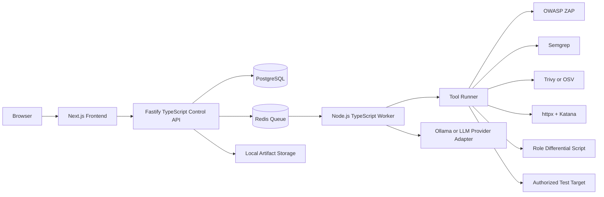
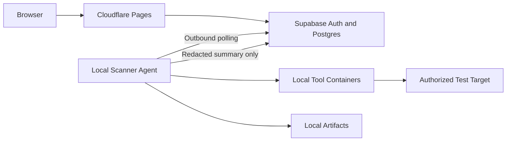

# AI White-box Pentest Orchestrator — MVP Implementation Plan

> สถานะ: Draft v0.1  
> เอกสารที่เกี่ยวข้อง: [AI_PENTEST_REQUIREMENTS_DRAFT.md](./AI_PENTEST_REQUIREMENTS_DRAFT.md)  
> เป้าหมาย: พิสูจน์ workflow ของ Proposed MVP Tool Set ด้วย stack ที่รันฟรีบนเครื่องก่อน และขยายเป็น hybrid free-hosted demo ภายหลัง

## 1. MVP objective

สร้างระบบต้นแบบที่ AI สามารถ:

1. รับ repository, target URL, scope และ test credentials
2. วิเคราะห์ tech stack และสร้าง attack surface
3. เลือกและเรียกใช้ ZAP, Semgrep, Trivy/OSV-Scanner, httpx และ Katana
4. เฝ้าดูสถานะและผลลัพธ์ของแต่ละ tool
5. Normalize และ deduplicate findings
6. สร้าง role-differential test สำหรับ access control
7. เลือก finding ที่ต้องตรวจซ้ำด้วย source context หรือ targeted runtime test
8. สร้างรายงาน Markdown พร้อม evidence provenance

MVP ต้องพิสูจน์ orchestration และ evidence flow ก่อนเพิ่มเครื่องมือเฉพาะทางจำนวนมาก

## 2. Recommended deployment strategy

### Stage A — Local-first, zero hosting cost

ระบบทั้งหมดรันผ่าน Docker Compose บนเครื่องนักพัฒนา:



ข้อดี:

- ไม่มีค่าบริการรายเดือน
- รัน Docker และ long-running scanners ได้
- Source code, credentials และ raw evidence ไม่ออกจากเครื่อง
- Debug adapter และ network policy ได้ง่าย
- ใช้ target ที่ตั้งใจให้มีช่องโหว่ใน local network ได้

### Stage B — Hybrid free-hosted demo

เมื่อ local MVP ทำงานแล้วจึงแยกส่วนที่เบาออกไปโฮสต์ฟรี:



ข้อกำหนดของ hybrid demo:

- Source code, credentials, raw HTTP traffic และ unredacted evidence ต้องอยู่ local
- Cloud database เก็บเฉพาะ project metadata, job state และผลที่ redact แล้ว
- Local Scanner Agent ใช้ outbound polling หรือ realtime subscription ไม่เปิด Docker socket หรือ scanner API สู่ Internet
- Demo cloud ใช้เฉพาะ intentionally vulnerable applications และข้อมูลทดสอบ

Cloudflare Pages/Workers ใช้สำหรับ UI และ request สั้น ๆ เท่านั้น ไม่ใช้รัน scanners หรือ AI orchestration ที่ใช้เวลานาน

## 3. Technology stack

### 3.1 Application stack

| Layer | Technology | เหตุผลสำหรับ MVP |
|---|---|---|
| Monorepo | Git + simple workspace layout | ลด tooling ที่ยังไม่จำเป็น |
| Frontend | Next.js + TypeScript + Tailwind CSS | ทำ dashboard, live job status และ finding review ได้เร็ว |
| Backend API | Fastify + TypeScript | ใช้ภาษาร่วมกับ frontend และตรวจ input ผ่าน schema ก่อนบันทึกหรือเข้าคิว |
| Worker | Node.js/TypeScript worker + Redis queue | แยก long-running assessment jobs ออกจาก HTTP request |
| Database | PostgreSQL | เก็บ assessments, jobs, findings, evidence metadata และ audit events |
| Database migrations | Flyway | รัน versioned SQL migrations ก่อน API และ worker เริ่มทำงาน |
| Queue/cache | Redis | job queue, progress, lock และ cancellation signal |
| Artifact storage | Local filesystem ใน MVP; MinIO เป็น optional | เก็บ raw JSON, SARIF, Markdown และ redacted evidence |
| Validation | Pydantic + JSON Schema | บังคับ normalized finding/tool schemas |
| Container runtime | Docker Compose | รัน application และ scanner containers แบบ reproducible |
| AI adapter | Provider-neutral interface; Ollama local เป็นตัวเลือกฟรี | เปลี่ยน local/hosted model โดยไม่เปลี่ยน orchestrator |
| Reporting | Jinja2 Markdown templates | สร้างรายงานที่ version control และ review ได้ |

### 3.2 Why PostgreSQL instead of a vector database initially

- Findings และ evidence เป็น structured data
- ใช้ PostgreSQL full-text search และ JSONB ได้เพียงพอสำหรับ MVP
- Source retrieval เริ่มจาก path, symbol, route และ line mapping
- เพิ่ม vector search เมื่อพิสูจน์แล้วว่าจำเป็นกับ repository ขนาดใหญ่

## 4. Repository structure

```text
ai-pentest-orchestrator/
├── apps/
│   ├── web/                    # Next.js frontend
│   ├── api/                    # Fastify TypeScript control plane and worker
│   │   └── migrations/         # Flyway versioned SQL migrations
├── packages/
│   ├── schemas/                # JSON Schema/Pydantic models
│   ├── tool-sdk/               # Adapter contract and runner client
│   ├── policies/               # Scope, approval and budget policies
│   └── reporting/              # Markdown templates
├── tools/
│   ├── zap/
│   ├── semgrep/
│   ├── trivy/
│   ├── discovery/
│   └── role-diff/
├── infrastructure/
│   ├── compose.yaml
│   └── database/
├── benchmarks/
│   ├── targets/
│   └── expected-findings/
├── assessment-output/
└── docs/
```

## 5. Core application components

### 5.1 Web frontend

หน้าหลักของ MVP:

1. **Projects** — repository และ assessment history
2. **New Assessment** — source, target, scope, credentials และ scan profile
3. **Attack Surface** — routes, technologies, auth flows และ coverage
4. **Live Run** — tool queue, status, logs, request count และ stop control
5. **Findings** — filter ตาม severity, confidence, category และ status
6. **Finding Review** — evidence, source trace, runtime proof และ decision
7. **Reports** — preview และ export Markdown bundle
8. **Settings** — model provider, tool versions และ safety budgets

Frontend ต้องไม่แสดง raw secrets และต้องเรียก stop scan ได้ตลอดเวลา

### 5.2 Fastify TypeScript control plane

รับผิดชอบ:

- Authentication และ project authorization
- Assessment CRUD
- Scope validation
- Tool registry API
- Job creation, cancellation และ status
- Findings/evidence queries
- Approval gates
- Report generation request
- Audit log queries

API ต้องไม่เรียก scanner แบบ synchronous ใน HTTP request

### 5.3 Node.js worker (AI orchestration is deferred)

รับผิดชอบ:

- Stack fingerprinting จาก repository manifest และ source layout
- สร้าง initial test plan
- เลือก adapters และ configuration
- ติดตาม coverage และผลแต่ละ tool
- สร้าง follow-up tasks ตาม evidence gap
- Correlate และ deduplicate findings
- ขอ approval ก่อน active/state-changing test
- สรุป reasoning เป็น decision record ที่ตรวจสอบได้

AI ต้องออกคำสั่งผ่าน typed actions เท่านั้น เช่น:

```json
{
  "action": "run_tool",
  "tool_id": "semgrep",
  "reason": "Node.js source detected; run relevant web and JWT rules",
  "scope_ref": "scope-001",
  "config_ref": "semgrep-node-quick-v1",
  "budget": {"timeout_seconds": 600}
}
```

AI ไม่มีสิทธิ์ส่ง arbitrary shell command โดยตรง

### 5.4 Tool runner

Tool Runner เป็นชั้นบังคับ policy ระหว่าง AI กับ tools:

- Resolve tool ID เป็น image และ version ที่ pin ไว้
- Validate input กับ schema
- Mount repository แบบ read-only
- จำกัด CPU, memory, process และ timeout
- ใช้ target allowlist และ network policy
- Stream structured progress
- Capture stdout/stderr, exit code และ artifacts
- รองรับ cancel/kill
- Hash configuration และ outputs เพื่อ provenance

## 6. Proposed MVP tool integrations

### 6.1 OWASP ZAP adapter

ขอบเขต MVP:

- Spider และ Ajax Spider
- Passive scan
- OpenAPI import ถ้ามี
- Authentication context แบบกำหนดค่าได้
- Selected active scan policy
- Progress, alert และ stop APIs
- Export raw alerts และ HTTP evidence

สิ่งที่ยังไม่ทำในรอบแรก:

- เปิดทุก active rule โดยไม่ fingerprint technology
- State-changing sequence scan
- Production scanning

### 6.2 Semgrep adapter

- ตรวจภาษา/framework ที่รองรับก่อนเลือกรuleset
- รองรับ community rules และ custom project rules
- รับ JSON/SARIF output
- แปลง path, line, rule ID, severity และ dataflow เป็น normalized evidence
- Mount repository read-only
- เก็บ ruleset version/hash

### 6.3 Trivy/OSV adapter

แนะนำให้เริ่มด้วย **Trivy ตัวเดียว** เพื่อลด integration เพราะครอบคลุม dependency, container, secret และ IaC ได้หลายด้าน แล้วเพิ่ม OSV-Scanner เพื่อเปรียบเทียบ dependency coverage ภายหลัง

MVP configuration:

- Dependency vulnerabilities
- Secret scanning
- Dockerfile/IaC misconfiguration
- JSON output
- Filter ตาม target type โดยไม่ทิ้ง raw results

### 6.4 Discovery adapter: httpx + Katana

- httpx ตรวจ live origin, status, title, headers และ technology hints
- Katana crawl routes, forms และ JavaScript-derived endpoints
- Merge runtime endpoints กับ source-derived routes
- Report coverage gap: source-only, runtime-only และ matched
- จำกัด host, depth, concurrency, rate และ maximum URLs

### 6.5 Custom role-differential adapter

นี่คือ custom feature ที่สร้างความต่างของ MVP

Input:

- Endpoint template
- Object identifiers
- Account/session ของแต่ละ role หรือ tenant
- Expected access policy
- Read-only/state-changing classification

Workflow:

1. บันทึก baseline response ของ owner
2. เปลี่ยน session เป็น role/tenant อื่น
3. ส่ง request ที่ปรับเฉพาะ identity/object ที่ได้รับอนุญาตให้ทดสอบ
4. เปรียบเทียบ status, body shape, sensitive fields และ side effects
5. ให้ AI ตรวจ source path และ authorization condition
6. สร้าง candidate finding พร้อม evidence

### 6.6 Custom normalization adapters

ทุก adapter ต้องส่ง output ขั้นต่ำ:

```json
{
  "tool_run_id": "TR-001",
  "tool": {"id": "zap", "version": "pinned"},
  "status": "completed",
  "coverage": {},
  "findings": [],
  "artifacts": [],
  "errors": [],
  "started_at": "...",
  "finished_at": "..."
}
```

Normalized finding ต้องแยก `severity`, `confidence`, `status` และ `evidence_quality`

## 7. Data model

ตารางหลัก:

| Table | หน้าที่ |
|---|---|
| users | ผู้ใช้และ role ภายในระบบ |
| projects | repository และ policy ของโปรเจกต์ |
| assessments | scope, commit, target และ scan profile |
| assets | hosts, endpoints, source components และ technologies |
| test_cases | test objective, preconditions และ expected control |
| tool_definitions | tool registry และ pinned version |
| tool_runs | config, status, budget และ provenance |
| findings | normalized vulnerability records |
| evidence | source/runtime evidence metadata และ artifact reference |
| approvals | active/state-changing approval records |
| audit_events | immutable user, AI และ tool actions |
| reports | report version และ output bundle |

Raw artifacts ไม่ควรถูกเก็บเป็น database blob ให้เก็บเป็นไฟล์และบันทึก hash/path ในตาราง evidence

## 8. Free hosting plan

### 8.1 Recommended first milestone: fully local

| Component | Free option |
|---|---|
| Frontend/API/Worker | Docker Compose บนเครื่องผู้พัฒนา |
| Database | PostgreSQL container |
| Queue | Redis container |
| Artifacts | Local volume |
| LLM | Ollama/local model หรือ provider adapter ที่ผู้ใช้กำหนด |
| Test target | OWASP Juice Shop container |
| CI | Local checks หรือ GitHub Actions allowance |

นี่คือเส้นทางหลัก เพราะ scanner containers ต้องใช้ CPU, memory, network control และเวลารันมากกว่าบริการ serverless ฟรีรองรับ

### 8.2 Optional hybrid demo

| Component | Free-hosted candidate | ข้อจำกัดที่ต้องยอมรับ |
|---|---|---|
| Static frontend | Cloudflare Pages | เหมาะกับ UI; dynamic functions มี runtime limits |
| Auth/metadata DB | Supabase Free | จำกัดพื้นที่, inactivity pause และไม่มี production SLA |
| Redacted artifacts | Supabase Storage Free | เก็บเฉพาะ demo data และ summary |
| Scanner/AI worker | Self-hosted local agent | เครื่องต้องออนไลน์ระหว่าง scan |
| CI | GitHub Actions public repo หรือ self-hosted runner | private repo มี allowance/usage limits |

ห้ามใช้ free cloud storage เก็บ repository ของลูกค้า, credentials หรือ raw pentest evidence ใน MVP

## 9. Test targets

### Primary benchmark

- **OWASP Juice Shop** รันใน local Docker network
- ใช้ทดสอบ JavaScript-heavy frontend, REST APIs, common vulnerabilities และ scanner coverage
- Pin image/version เพื่อให้ผล benchmark ทำซ้ำได้

### Secondary targets after the first end-to-end run

- Target สำหรับ API authorization และ multi-role โดยเฉพาะ
- Target ขนาดเล็กที่ทีมสร้างเอง พร้อม seeded vulnerabilities และ ground truth
- Sample repositories สำหรับ Semgrep, secrets, dependencies และ IaC

ไม่ใช้เว็บไซต์สาธารณะเป็น benchmark target

## 10. Delivery plan

### Milestone 0 — Foundation (สัปดาห์ 1)

- สร้าง monorepo และ Docker Compose
- สร้าง frontend/API/worker skeleton
- สร้าง PostgreSQL schema และ Flyway migrations
- สร้าง tool registry, job และ audit models
- รัน Juice Shop ใน isolated test network

**Exit:** UI สร้าง assessment และ worker รับ dummy job ได้

### Milestone 1 — Source intake and stack detection (สัปดาห์ 2)

- Import local repository/ZIP
- เก็บ commit/source hash
- ตรวจ manifests, languages และ frameworks
- Extract source-derived routes เบื้องต้น
- Enforce read-only repository mount

**Exit:** แสดง stack และ source attack surface ใน UI ได้

### Milestone 2 — Static tool pipeline (สัปดาห์ 3)

- Semgrep adapter
- Trivy adapter
- JSON/SARIF artifact storage
- Normalize และ deduplicate findings
- แสดง findings พร้อม file/line และ tool provenance

**Exit:** assessment จาก source สร้าง finding summary ได้

### Milestone 3 — Discovery pipeline (สัปดาห์ 4)

- httpx adapter
- Katana adapter
- Scope/redirect/DNS checks
- URL budget, rate limit และ cancellation
- Merge source routes กับ runtime endpoints

**Exit:** UI แสดง endpoint coverage และ gaps ได้

### Milestone 4 — ZAP runtime pipeline (สัปดาห์ 5)

- ZAP daemon/container integration
- Spider, passive scan และ API import
- Progress monitoring และ stop
- Selected active scan หลัง approval
- Normalize alerts และ HTTP evidence

**Exit:** รัน authenticated/passive assessment บน test target ได้

### Milestone 5 — AI orchestration (สัปดาห์ 6)

- Provider-neutral AI adapter
- Typed orchestration actions
- Tool selection จาก stack/scope
- Follow-up planning จาก coverage gaps
- Tool failure handling และ decision records
- Budget enforcement นอกโมเดล

**Exit:** AI เลือก scan sequence และอธิบายเหตุผลได้ โดยไม่มี arbitrary shell access

### Milestone 6 — Access-control differentiator (สัปดาห์ 7)

- Credential/session profiles
- Role/action/object matrix
- Role-differential runner
- Response comparison และ side-effect guard
- AI source trace ของ authorization path

**Exit:** ตรวจ access-control scenario แบบสอง roles และสร้าง evidence ได้

### Milestone 7 — Reporting and benchmark (สัปดาห์ 8)

- Markdown report templates
- Findings, coverage gaps, tool failures และ audit log
- Retest workflow
- Benchmark กับ pinned Juice Shop version และ seeded app
- วัด precision, recall proxy, runtime และ duplicate rate

**Exit:** assessment ตั้งแต่ intake ถึง Markdown bundle ทำงานครบหนึ่งรอบ

## 11. MVP acceptance criteria

- เริ่มระบบทั้งหมดได้ด้วย Docker Compose
- ใช้ได้โดยไม่มี cloud account
- AI ตรวจ stack และเลือก tools จาก registry ได้
- Tool Runner บังคับ timeout, read-only source mount และ target allowlist ได้
- ZAP, Semgrep, Trivy, httpx และ Katana ส่งผลเข้า schema กลางได้
- ยกเลิก running scan จาก UI ได้
- แสดง source/runtime endpoint coverage ได้
- รองรับ test identities อย่างน้อยสอง roles
- แยก candidate, needs-validation, confirmed และ false-positive ได้
- ทุก finding ย้อนกลับไปยัง tool version, config hash และ artifact ได้
- สร้าง Markdown report bundle ตาม requirements ได้
- รายงาน tool failure และ untested coverage อย่างชัดเจน
- ไม่มี source, credential หรือ raw evidence ถูกส่งออกนอกเครื่องใน local mode

## 12. Cost boundary

ค่าใช้จ่ายที่ควรเป็นศูนย์ในระยะพิสูจน์แนวคิด:

- Application hosting: local Docker Compose
- Database/queue/storage: local containers/volumes
- Scanners: open-source editions
- Test target: intentionally vulnerable local container
- AI: local model หากเครื่องรองรับ

ต้นทุนที่อาจเกิดขึ้นภายหลัง:

- Hosted LLM API
- เครื่องที่มี RAM/GPU สำหรับ local model
- Cloud worker สำหรับ scanner jobs
- Artifact retention และ backup
- Commercial scanner/rules/licenses
- Private CI usage เกิน allowance

## 13. Decisions before implementation

1. ใช้ Windows + Docker Desktop/WSL2 เป็น development baseline หรือ Linux native
2. เลือก local model ขั้นต่ำตาม RAM/GPU ที่มี
3. เลือก first source framework: แนะนำ Node.js/Express เพื่อใช้ร่วมกับ Juice Shop
4. กำหนดว่า MVP ต้องรองรับ Git clone หรือเริ่มจาก local folder/ZIP
5. กำหนด credential format สำหรับสอง roles
6. กำหนด active-scan approval UX
7. กำหนด benchmark findings ชุดแรกและ confirmation policy

## 14. Recommended starting decision

เริ่มด้วย configuration นี้:

- Local-only Docker Compose
- Next.js + Fastify/TypeScript + Node.js/TypeScript worker
- PostgreSQL + Redis + local artifacts
- ZAP + Semgrep + Trivy + httpx + Katana
- Node.js/Express เป็น source framework แรก
- OWASP Juice Shop เป็น runtime benchmark แรก
- Ollama/local model เป็น optional; mock deterministic planner ใช้ได้ก่อน AI integration
- Quick scan profile ก่อน authenticated deep scan

แนวทางนี้พิสูจน์ architecture และ tool integration ได้โดยไม่ผูกกับ free tier ของผู้ให้บริการ และยังย้าย frontend/metadata ไป cloud ภายหลังได้โดยไม่ย้าย scanner worker

